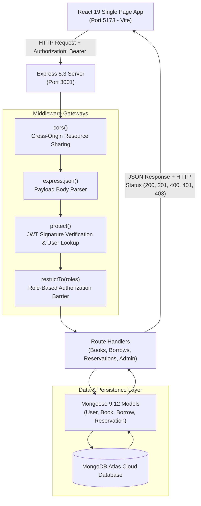
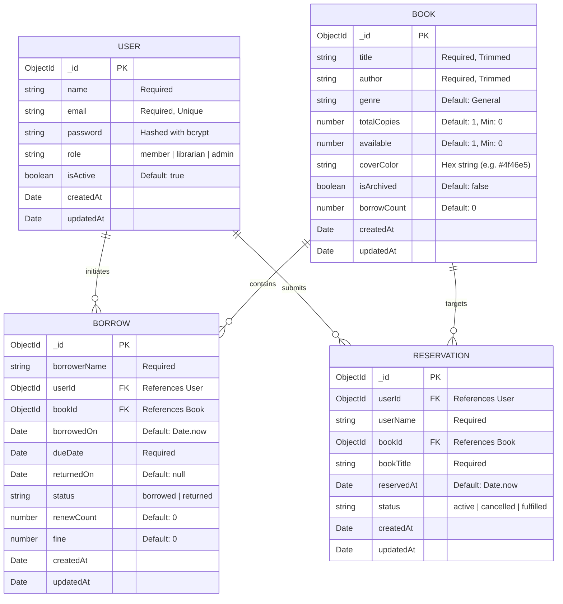

<div align="center">

# 📚 Library Management System

### *A Modern Archival & Circulation Platform with Role-Based Access Control*

[](https://react.dev/)
[](https://expressjs.com/)
[](https://www.mongodb.com/)
[](https://jwt.io/)
[](LICENSE)

<br/>

<p align="center">
  
</p>

<p align="center">
  A full-stack, enterprise-grade academic library management platform engineered with <b>React 19</b>, <b>Express 5</b>, and <b>MongoDB Atlas</b>.<br/>
  Featuring an interactive <b>3D book stack viewer</b>, fine-grained <b>Role-Based Access Control (RBAC)</b>, 1-click book reservations, 14-day circulation lifecycle tracking, and an automated overdue fine calculation engine.
</p>

</div>

---

## 📑 Table of Contents

- [Overview & Objectives](#-overview--objectives)
- [Interactive 3D Book-Stack Model](#-interactive-3d-book-stack-model)
- [System Architecture & Lifecycle](#-system-architecture--lifecycle)
- [Database Schema & Entity Relationships](#-database-schema--entity-relationships)
- [Technology Stack](#-technology-stack)
- [Role-Based Feature Matrix](#-role-based-feature-matrix)
- [Core Workflows & Features](#-core-workflows--features)
  - [1. Authentication & RBAC Engine](#1-authentication--rbac-engine)
  - [2. Catalogue Management & CRUD](#2-catalogue-management--crud)
  - [3. Circulation Lifecycle (Issue, Renew, Return)](#3-circulation-lifecycle-issue-renew-return)
  - [4. Dynamic Overdue Fine Calculation](#4-dynamic-overdue-fine-calculation)
  - [5. Book Reservation System](#5-book-reservation-system)
  - [6. Administrative Governance & Analytics](#6-administrative-governance--analytics)
- [REST API Reference](#-rest-api-reference)
- [Team Members & Contributions](#-team-members--contributions)
- [Local Setup & Installation](#-local-setup--installation)
- [Default Demonstration Accounts](#-default-demonstration-accounts)

---

## 🎯 Overview & Objectives

Traditional library tracking systems frequently rely on paper logbooks, manual fine recording, and fragmented spreadsheets. This system provides a unified, secure, and automated digital solution for academic institutions and public archival centers.

### Key Objectives:
1. **Stateless Security & RBAC:** Enforce strict identity verification and role-partitioned privileges (Member, Librarian, Administrator) using cryptographically signed JSON Web Tokens (JWT) and 10-round salted Bcrypt password hashing.
2. **Automated Circulation Lifecycle:** Replace manual bookkeeping with automated 14-day checkout periods, return validations, renewal tracking, and shelf inventory updates.
3. **Dynamic Fine Computation:** Calculate late fees in real time based on active overdue days ($₹2/\text{day}$ default) directly from timestamp discrepancies without requiring manual staff calculation.
4. **Academic Demand Balancing:** Allow students to place holds on high-demand books via a reservation pipeline that tracks requests until stock becomes available.
5. **Modern Interactive Experience:** Deliver an interface featuring responsive glassmorphic modals, multi-filter search, and interactive 3D book visualizations.

---

## 🧊 Interactive 3D Book-Stack Model

> **GitHub 3D Viewport:** GitHub natively renders the ASCII STL block below into an interactive 3D canvas. Click and drag with your left mouse button to rotate, scroll to zoom in/out, and right-click to pan across the 3D book stack.

```stl
solid book_stack
  facet normal 0.0 0.0 -1.0
    outer loop
      vertex -35.0 -50.0 0
      vertex 35.0 50.0 0
      vertex 35.0 -50.0 0
    endloop
  endfacet
  facet normal 0.0 0.0 -1.0
    outer loop
      vertex -35.0 -50.0 0
      vertex -35.0 50.0 0
      vertex 35.0 50.0 0
    endloop
  endfacet
  facet normal 0.0 0.0 1.0
    outer loop
      vertex -35.0 -50.0 15
      vertex 35.0 -50.0 15
      vertex 35.0 50.0 15
    endloop
  endfacet
  facet normal 0.0 0.0 1.0
    outer loop
      vertex -35.0 -50.0 15
      vertex 35.0 50.0 15
      vertex -35.0 50.0 15
    endloop
  endfacet
  facet normal 0.0 -1.0 0.0
    outer loop
      vertex -35.0 -50.0 0
      vertex 35.0 -50.0 0
      vertex 35.0 -50.0 15
    endloop
  endfacet
  facet normal 0.0 -1.0 0.0
    outer loop
      vertex -35.0 -50.0 0
      vertex 35.0 -50.0 15
      vertex -35.0 -50.0 15
    endloop
  endfacet
  facet normal 0.0 1.0 0.0
    outer loop
      vertex -35.0 50.0 0
      vertex 35.0 50.0 15
      vertex 35.0 50.0 0
    endloop
  endfacet
  facet normal 0.0 1.0 0.0
    outer loop
      vertex -35.0 50.0 0
      vertex -35.0 50.0 15
      vertex 35.0 50.0 15
    endloop
  endfacet
  facet normal -1.0 0.0 0.0
    outer loop
      vertex -35.0 -50.0 0
      vertex -35.0 -50.0 15
      vertex -35.0 50.0 15
    endloop
  endfacet
  facet normal -1.0 0.0 0.0
    outer loop
      vertex -35.0 -50.0 0
      vertex -35.0 50.0 15
      vertex -35.0 50.0 0
    endloop
  endfacet
  facet normal 1.0 0.0 0.0
    outer loop
      vertex 35.0 -50.0 0
      vertex 35.0 50.0 0
      vertex 35.0 50.0 15
    endloop
  endfacet
  facet normal 1.0 0.0 0.0
    outer loop
      vertex 35.0 -50.0 0
      vertex 35.0 50.0 15
      vertex 35.0 -50.0 15
    endloop
  endfacet
  facet normal 0.0 0.0 -1.0
    outer loop
      vertex -23.53 -50.86 15
      vertex 23.53 50.86 15
      vertex 39.5 -39.74 15
    endloop
  endfacet
  facet normal 0.0 0.0 -1.0
    outer loop
      vertex -23.53 -50.86 15
      vertex -39.5 39.74 15
      vertex 23.53 50.86 15
    endloop
  endfacet
  facet normal 0.0 0.0 1.0
    outer loop
      vertex -23.53 -50.86 28
      vertex 39.5 -39.74 28
      vertex 23.53 50.86 28
    endloop
  endfacet
  facet normal 0.0 -0.0 1.0
    outer loop
      vertex -23.53 -50.86 28
      vertex 23.53 50.86 28
      vertex -39.5 39.74 28
    endloop
  endfacet
  facet normal 0.1737 -0.9848 0.0
    outer loop
      vertex -23.53 -50.86 15
      vertex 39.5 -39.74 15
      vertex 39.5 -39.74 28
    endloop
  endfacet
  facet normal 0.1737 -0.9848 0.0
    outer loop
      vertex -23.53 -50.86 15
      vertex 39.5 -39.74 28
      vertex -23.53 -50.86 28
    endloop
  endfacet
  facet normal -0.1737 0.9848 0.0
    outer loop
      vertex -39.5 39.74 15
      vertex 23.53 50.86 28
      vertex 23.53 50.86 15
    endloop
  endfacet
  facet normal -0.1737 0.9848 0.0
    outer loop
      vertex -39.5 39.74 15
      vertex -39.5 39.74 28
      vertex 23.53 50.86 28
    endloop
  endfacet
  facet normal -0.9848 -0.1736 0.0
    outer loop
      vertex -23.53 -50.86 15
      vertex -23.53 -50.86 28
      vertex -39.5 39.74 28
    endloop
  endfacet
  facet normal -0.9848 -0.1736 0.0
    outer loop
      vertex -23.53 -50.86 15
      vertex -39.5 39.74 28
      vertex -39.5 39.74 15
    endloop
  endfacet
  facet normal 0.9848 0.1736 0.0
    outer loop
      vertex 39.5 -39.74 15
      vertex 23.53 50.86 15
      vertex 23.53 50.86 28
    endloop
  endfacet
  facet normal 0.9848 0.1736 -0.0
    outer loop
      vertex 39.5 -39.74 15
      vertex 23.53 50.86 28
      vertex 39.5 -39.74 28
    endloop
  endfacet
  facet normal 0.0 0.0 -1.0
    outer loop
      vertex -33.57 -37.69 28
      vertex 33.57 37.69 28
      vertex 21.88 -45.49 28
    endloop
  endfacet
  facet normal 0.0 0.0 -1.0
    outer loop
      vertex -33.57 -37.69 28
      vertex -21.88 45.49 28
      vertex 33.57 37.69 28
    endloop
  endfacet
  facet normal -0.0 0.0 1.0
    outer loop
      vertex -33.57 -37.69 39
      vertex 21.88 -45.49 39
      vertex 33.57 37.69 39
    endloop
  endfacet
  facet normal 0.0 0.0 1.0
    outer loop
      vertex -33.57 -37.69 39
      vertex 33.57 37.69 39
      vertex -21.88 45.49 39
    endloop
  endfacet
  facet normal -0.1393 -0.9903 0.0
    outer loop
      vertex -33.57 -37.69 28
      vertex 21.88 -45.49 28
      vertex 21.88 -45.49 39
    endloop
  endfacet
  facet normal -0.1393 -0.9903 0.0
    outer loop
      vertex -33.57 -37.69 28
      vertex 21.88 -45.49 39
      vertex -33.57 -37.69 39
    endloop
  endfacet
  facet normal 0.1393 0.9903 0.0
    outer loop
      vertex -21.88 45.49 28
      vertex 33.57 37.69 39
      vertex 33.57 37.69 28
    endloop
  endfacet
  facet normal 0.1393 0.9903 -0.0
    outer loop
      vertex -21.88 45.49 28
      vertex -21.88 45.49 39
      vertex 33.57 37.69 39
    endloop
  endfacet
  facet normal -0.9903 0.1392 0.0
    outer loop
      vertex -33.57 -37.69 28
      vertex -33.57 -37.69 39
      vertex -21.88 45.49 39
    endloop
  endfacet
  facet normal -0.9903 0.1392 0.0
    outer loop
      vertex -33.57 -37.69 28
      vertex -21.88 45.49 39
      vertex -21.88 45.49 28
    endloop
  endfacet
  facet normal 0.9903 -0.1392 0.0
    outer loop
      vertex 21.88 -45.49 28
      vertex 33.57 37.69 28
      vertex 33.57 37.69 39
    endloop
  endfacet
  facet normal 0.9903 -0.1392 0.0
    outer loop
      vertex 21.88 -45.49 28
      vertex 33.57 37.69 39
      vertex 21.88 -45.49 39
    endloop
  endfacet
endsolid book_stack
```

---

## 🏛️ System Architecture & Lifecycle

All authenticated traffic flows through a layered architectural pipeline:



---

## 🗄️ Database Schema & Entity Relationships

The database architecture is implemented with strict Mongoose validation, indexes, and document references:



---

## 💻 Technology Stack

Every technology listed below is verified from `package.json` and project source code:

### Frontend
- **React 19 (`react` 19.3.1, `react-dom` 19.3.1):** Modern UI layer utilizing functional components, hooks (`useState`, `useEffect`, `useRef`), and component-level state updates.
- **Vite 8 (`vite` 8.3.6):** High-performance bundler and dev server with fast Hot Module Replacement (HMR).
- **Pure CSS3 Design System:** Fully custom styling without external UI frameworks. Uses CSS Grid, Flexbox, CSS Custom Properties (variables), glassmorphic backdrops, and 3D transform perspectives (`rotateX`, `rotateY`, `perspective`).
- **Oxlint (`oxlint` 1.90.0):** Rust-based linter for high-speed static code quality checks.

### Backend
- **Node.js & Express 5.3 (`express` 5.3.0):** Modern HTTP server routing, JSON parsing, and async/await middleware error handling.
- **JSON Web Token (`jsonwebtoken` 9.0.3):** Stateless authentication tokens signed with HMAC-SHA256 and configurable expiration.
- **Bcrypt.js (`bcryptjs` 3.0.3):** Adaptive cryptographic password hashing with 10 salt rounds to defend against dictionary and rainbow-table attacks.
- **CORS (`cors` 2.8.6):** Cross-Origin Resource Sharing middleware facilitating communication between the frontend (port 5173) and backend (port 3001).
- **Dotenv (`dotenv` 18.0.10):** Environment configuration management for database URIs, port allocation, and security secrets.
- **Nodemon (`nodemon` 3.1.11):** Development hot-reload monitor for node processes.

### Database
- **MongoDB Atlas:** Cloud-hosted NoSQL document database.
- **Mongoose 9.12 (`mongoose` 9.12.1):** Object Data Modeling (ODM) providing schema enforcement, type validation, pre-save hooks, and aggregation pipelines.

---

## 📊 Role-Based Feature Matrix

| Functional Capability | Student Member | Librarian Staff | System Administrator |
| :--- | :---: | :---: | :---: |
| Browse & Search Book Catalog | ✅ | ✅ | ✅ |
| Reserve Depleted or Active Titles | ✅ | ❌ | ❌ |
| View Personal Loans & Overdue Dues | ✅ | ❌ | ❌ |
| View Personal Borrowing History | ✅ | ❌ | ❌ |
| Cancel Personal Active Reservation | ✅ | ❌ | ❌ |
| Add New Book to Catalog | ❌ | ✅ | ✅ |
| Update Book Metadata & Total Copies | ❌ | ✅ | ✅ |
| Soft-Archive / Unarchive Title | ❌ | ✅ | ✅ |
| Permanently Delete Book Document | ❌ | ❌ | ✅ |
| Issue Book to Registered Member | ❌ | ✅ | ✅ |
| Process Book Returns & Accrue Fines | ❌ | ✅ | ✅ |
| Renew Loan Duration (+14 Days) | ❌ | ✅ | ✅ |
| View Campus Overdue Loans List | ❌ | ✅ | ✅ |
| View System Statistics & Analytics | ❌ | ❌ | ✅ |
| Promote / Demote User Roles | ❌ | ❌ | ✅ |
| Activate / Deactivate Accounts | ❌ | ❌ | ✅ |

---

## ⚙️ Core Workflows & Features

### 1. Authentication & RBAC Engine
- **Stateless Authorization:** Authenticated clients receive a cryptographically signed JWT stored in client memory/storage and transmitted via the standard `Authorization: Bearer <token>` header.
- **Password Security:** All passwords undergo 10-round salted hashing using `bcryptjs` before insertion into MongoDB.
- **Dual-Barrier Middleware:**
  - `protect`: Extracts token, verifies signature against `JWT_SECRET`, and retrieves the active user from MongoDB.
  - `restrictTo(...roles)`: Verifies if `req.user.role` is authorized to access the specific endpoint, returning `403 Forbidden` on unauthorized requests.

### 2. Catalogue Management & CRUD
- **Comprehensive CRUD Operations:** Add, update, view, and delete book documents.
- **Soft-Archiving (`isArchived: true`):** Books can be archived by librarians to remove them from member search queries while preserving active loan history and database relational integrity.
- **Multi-Criteria Search:** Fast client-side filtering by book title, author, and genre.

### 3. Circulation Lifecycle (Issue, Renew, Return)
- **Book Issuance:** Checks if `book.available > 0`, decrements available count, increments `borrowCount`, and sets a 14-day loan schedule.
- **Loan Renewals:** Extends the loan due date by 14 days and increments `renewCount`.
- **Book Returns:** Increments `book.available`, marks borrow status as `returned`, records the `returnedOn` timestamp, and freezes the final calculated fine.

### 4. Dynamic Overdue Fine Calculation
Overdue fines are calculated on-the-fly dynamically without requiring scheduled cron jobs:
$$\text{Days Overdue} = \left\lceil \frac{\text{Current Date} - \text{Due Date}}{1000 \times 60 \times 60 \times 24} \right\rceil$$
$$\text{Calculated Fine} = \max(0, \, \text{Days Overdue}) \times \text{FINE\_PER\_DAY (₹2)}$$

### 5. Book Reservation System
- Members can place reservations on books (`status: 'active'`).
- Prevents duplicate reservations for the same member on the same title.
- Members can cancel active reservations at any time.

### 6. Administrative Governance & Analytics
- **System Statistics:** Real-time metrics including total titles, archived counts, total members/librarians/admins, active loans, returned loans, total overdue fines collected, and top 5 popular books.
- **User Role Management:** Admins can promote or demote user roles between `member`, `librarian`, and `admin` with self-demotion protection to prevent lockout.
- **Account Status Toggle:** Admins can deactivate accounts (`isActive: false`), blocking login access.

---

## 📡 REST API Reference

<details>
<summary><b>1. Authentication Routes (<code>/api/auth</code>) — Click to Expand</b></summary>
<br/>

| Method | Endpoint | Authorization | Description |
| :--- | :--- | :--- | :--- |
| `POST` | `/api/auth/register` | Public | Registers a new member account with salted password |
| `POST` | `/api/auth/login` | Public | Validates credentials and returns signed JWT token |
| `GET` | `/api/auth/me` | Protected | Fetches authenticated user profile and role |

</details>

<details>
<summary><b>2. Book Catalog Routes (<code>/api/books</code>) — Click to Expand</b></summary>
<br/>

| Method | Endpoint | Authorization | Description |
| :--- | :--- | :--- | :--- |
| `GET` | `/api/books` | Public / Member | Retrieves all non-archived books for catalog display |
| `GET` | `/api/books/all` | Librarian, Admin | Retrieves complete catalog including archived titles |
| `POST` | `/api/books` | Librarian, Admin | Adds a new book document to the inventory |
| `PUT` | `/api/books/:id` | Librarian, Admin | Updates book title, author, genre, totalCopies, coverColor |
| `PATCH` | `/api/books/:id/archive` | Librarian, Admin | Toggles soft-archive status |
| `DELETE` | `/api/books/:id` | Admin | Permanently deletes a book record from database |

</details>

<details>
<summary><b>3. Borrow & Circulation Routes (<code>/api/borrows</code>) — Click to Expand</b></summary>
<br/>

| Method | Endpoint | Authorization | Description |
| :--- | :--- | :--- | :--- |
| `POST` | `/api/borrows/issue` | Librarian, Admin | Issues a book copy to a member and decrements availability |
| `PATCH` | `/api/borrows/:id/renew` | Librarian, Admin | Extends loan due date by 14 days |
| `PATCH` | `/api/borrows/:id/return` | Librarian, Admin | Marks loan as returned, calculates final fine, increments stock |
| `GET` | `/api/borrows/my` | Member | Retrieves active loans and return history for current user |
| `GET` | `/api/borrows/overdue` | Librarian, Admin | Retrieves all active loans that have passed their due date |

</details>

<details>
<summary><b>4. Reservation Routes (<code>/api/reservations</code>) — Click to Expand</b></summary>
<br/>

| Method | Endpoint | Authorization | Description |
| :--- | :--- | :--- | :--- |
| `POST` | `/api/reservations` | Member | Submits a book reservation request |
| `GET` | `/api/reservations/my` | Member | Retrieves all active and historical reservations for current user |
| `PATCH` | `/api/reservations/:id/cancel` | Member | Cancels an active reservation |

</details>

<details>
<summary><b>5. Administration Routes (<code>/api/admin</code>) — Click to Expand</b></summary>
<br/>

| Method | Endpoint | Authorization | Description |
| :--- | :--- | :--- | :--- |
| `GET` | `/api/admin/stats` | Admin | Aggregated platform metrics and top borrowed books |
| `GET` | `/api/admin/users` | Admin | Lists all user accounts with roles and statuses |
| `PATCH` | `/api/admin/users/:id/role` | Admin | Updates user role (member, librarian, admin) |
| `PATCH` | `/api/admin/users/:id/status` | Admin | Toggles account active/inactive status |

</details>

---

## 👥 Team Members & Contributions

| Member | Role | Responsibilities |
| :--- | :--- | :--- |
| **Ronit Khanna** | **Team Leader** | Authentication, JWT, role-based access, MongoDB integration, frontend and backend integration, deployment |
| **Ritika** | **Backend Developer** | Book management, CRUD APIs, search and filtering |
| **Sneha** | **Backend Developer** | Issue/return system, renewals, reservations and fines |
| **Rekha** | **Backend Developer & QA** | Admin reports, API testing, documentation and viva preparation |

---

## 🚀 Local Setup & Installation

### Prerequisites
- **Node.js** (v18.0.0 or higher)
- **npm** (v9.0.0 or higher)
- **MongoDB Atlas** account or a local MongoDB community server

### 1. Clone the Repository
```bash
git clone https://github.com/ronit0699/BEE-2.git
cd BEE-2
```

### 2. Configure Backend Environment
Create a `.env` file in the `backend/` directory:
```env
PORT=3001
MONGODB_URI=your_mongodb_connection_string
JWT_SECRET=your_jwt_secret_key_here
JWT_EXPIRES_IN=7d
FINE_PER_DAY=2
```

### 3. Install Dependencies & Seed Demo Data
```bash
# Navigate to backend
cd backend
npm install

# Populate MongoDB with initial books, users, loans, and reservations
node seed.js

# Start backend server in development mode
npm run dev
```
*The Express server will launch on `http://localhost:3001`.*

### 4. Install & Launch Frontend
```bash
# Open a new terminal session and navigate to frontend
cd frontend
npm install

# Start Vite development server
npm run dev
```
*The Vite client will launch on `http://localhost:5173`.*

---

## 🔑 Default Demonstration Accounts

The database seed script (`backend/seed.js`) provides pre-configured credentials across all three operational roles:

| Portal Tier | Account Email | Password | Access Capabilities |
| :--- | :--- | :--- | :--- |
| 👑 **Administrator** | `admin@library.com` | `admin123` | Complete system access: user roles, account activation, system statistics |
| 📚 **Librarian** | `librarian@library.com` | `librarian123` | Operational access: book catalogue CRUD, issues, renewals, returns, overdue logs |
| 👤 **Student Member** | `member@library.com` | `member123` | Student access: catalogue search, reservations, active loans, dynamic fine viewer |

---

<div align="center">

<sub>Library Management System • Developed by the BEE Engineering Group</sub>

</div>

